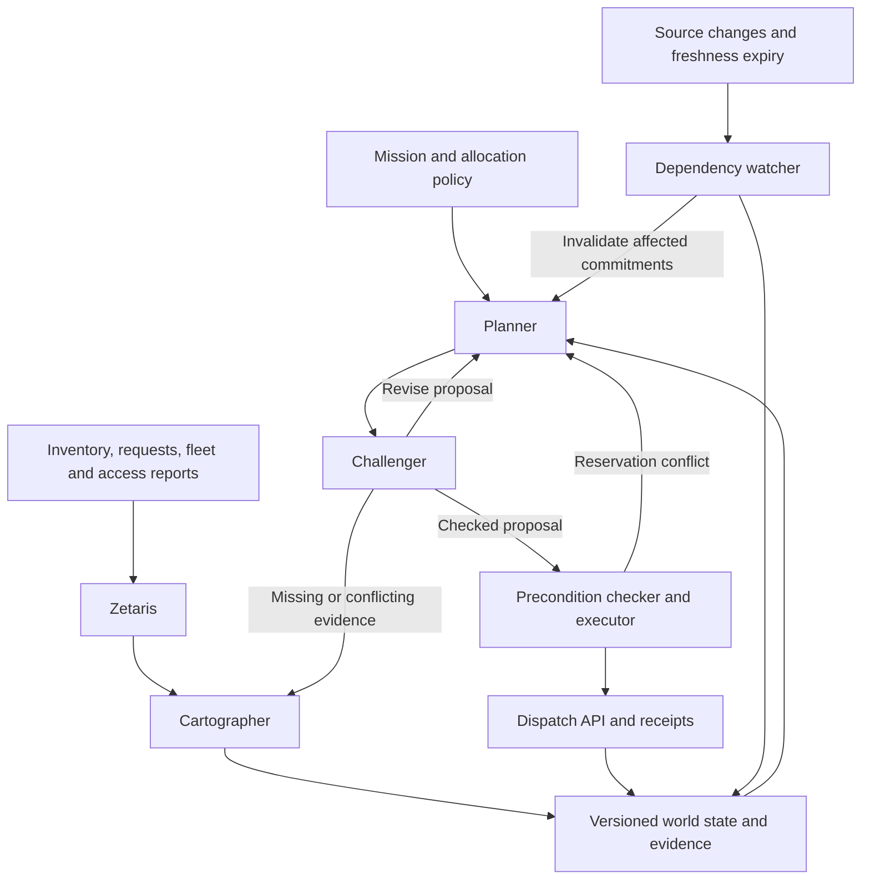

**AFTERSHOCK — Keep the mission alive when the plan breaks.**

Concept draft for the Open Agent Hackathon 2026. Prepared 22 October 2026. This document describes a proposed build; the scenarios, targets and outputs below are not measured results.

My strongest bet is an agent that remains responsible for its decisions after making them.

At 16:07, a bridge closes. A relief coordinator's dispatch board still shows four green deliveries. The routes were valid when someone approved them. Two are now impossible, and the vehicles have not left yet.

AFTERSHOCK connects the changed road record to the commitments that depended on it, suspends their release, finds a feasible repair, updates the dispatch system and explains exactly what changed. Its central promise is simple: every action stays attached to the evidence that justified it.

The opening use case is a municipal or NGO relief dispatcher coordinating supplies across depots, vehicles and shelters during a flood. The hackathon implementation covers one fictional district and a software dispatch sandbox. The long-term product is a reusable way for agents to maintain operational commitments as reality changes.

**The primary track is Reasoning Architecture.** Its central contribution is the connection between changing evidence, persistent memory and executable actions. That directly matches the event's description of the track. The current official event page confirms the 22–27 October build window and the 27 October, 23:45 UTC submission deadline. [Official event page](https://hackathon.genai.works/event/open-agent-hackathon-2026)

The user gives it a mission such as: “Get 240 relief kits to these four shelters by 18:00, using the available depots and vehicles. Follow this allocation policy.” The quantities are synthetic scenario inputs. The system investigates whether the mission is feasible, proposes allocations, verifies them, creates reservations and dispatch orders, and monitors the facts those orders depend on.

There is a documented need behind this scenario. The Logistics Cluster describes humanitarian supply chains as dynamic and identifies the speed and reliability of critical information as a coordination problem. Its LogIE platform already brings logistics information together. AFTERSHOCK's proposed contribution sits at the next operational step: maintaining the validity of actions taken from that information. This is a product hypothesis to validate with a dispatcher, not a claim of field deployment. [LogIE](https://logcluster.org/en/what-we-do/emergency-response/logie)

**The distinctive primitive is a living commitment.** Every proposed dispatch has an explicit outcome, evidence dependencies, conditions for execution and a defined response if those conditions fail.

| Part of the commitment | Illustrative content |
| --- | --- |
| Outcome | Reserve and dispatch 60 kits from Depot A to Shelter North before 18:00 |
| Supporting evidence | Inventory row, vehicle availability record, shelter request and route records, each with a source identifier and version |
| Execution conditions | Enough unreserved kits; available vehicle; sufficient capacity; open route; arrival within the requested window |
| Recheck triggers | A supporting record changes, its freshness limit expires, or a conflicting observation arrives |
| Permitted recovery | Hold an unreleased order, release its reservations, validate a replacement and issue a new order |
| Result evidence | Reservation IDs, API receipts, current order status and the source versions checked |

A deterministic checker evaluates the explicit conditions. Its receipt establishes that the action passed the implemented checks against the observed state. It does not establish that the sources are infallible or that every real-world hazard has been modeled.

The dependency graph makes a fact change actionable. A road closure can invalidate two routes, which can invalidate two dispatch commitments. The system identifies that affected portion and preserves other commitments when the resource constraints allow it. If repairing those orders requires reallocating shared stock or vehicles, the affected portion expands accordingly.

The agent also retains rejected alternatives. If a vehicle was ruled out because of a maintenance record, that exclusion survives context compression and restart until superseding evidence resolves it. This gives the project an additional, testable reasoning question: can an agent keep reasoning cheaply without forgetting why an attractive action was rejected?

Humanitarian mapping and dependency-based reasoning have substantial prior art. Dependency-directed backtracking appears in early truth-maintenance research. The defensible innovation claim is this particular integration: adversarial investigation, explicit action conditions, bounded reasoning, persistent exclusions and selective repair, demonstrated through actual application state changes. [Jon Doyle, A Glimpse of Truth Maintenance](https://dspace.mit.edu/entities/publication/ec59eeeb-5e11-44df-ab1b-6524ca7ab9ff)

**Three reasoning agents have distinct authority.** Their tools and shared state make their interaction observable.

| Agent | Responsibility | How it changes another agent's work |
| --- | --- | --- |
| Cartographer | Queries sources, resolves identifiers and records contradictions, provenance and freshness | Returns unresolved facts that require the Planner to change its plan; executes specific evidence requests from the Challenger |
| Planner | Proposes allocations and recovery options using routing and scheduling tools | Requests missing information and revises proposals after a rejection, changed fact or execution conflict |
| Challenger | Searches for evidence that could invalidate a proposed commitment; invokes independent checks | Blocks release, identifies an unsupported assumption and sends a targeted query back to the Cartographer |

A deterministic watcher identifies changed dependencies. A deterministic executor enforces checked preconditions, handles reservations and records receipts. Neither is counted as an extra reasoning agent.

An illustrative interaction is: the Planner selects a vehicle; the Challenger finds that availability came from an old roster and requests its current status; the Cartographer retrieves a maintenance hold; the Planner revises the allocation; the Challenger verifies the replacement; the executor reserves the resources. Later, a road event reopens the affected commitment without a second user prompt. Every step must arise from the current input and actual tool results.

The language model chooses investigation steps and recovery strategies. Ordinary code calculates capacities, travel times and allocation feasibility. The operator supplies the allocation policy; the model cannot invent different priorities to make its answer look better. An infeasible mission produces a quantified shortfall and the constraints causing it.

**The sponsors support necessary parts of that behavior.**

Zetaris is the reasoning agents' access point to fragmented operational data. The proposed sources are a depot inventory database, shelter requests in CSV stored where Zetaris can reach them, and fleet/access-report REST services. These remain separate source systems. A query must connect a request to available stock, a usable vehicle and a supported route. Zetaris publishes REST and file-source recipes and connection helpers; the exact source registrations must be proven on day one. [Zetaris getting-started repository](https://github.com/zetaris/getting-started)

The project records provenance itself: source, record identifier, observed timestamp, version or content hash, query and retrieved result. It must not assume that a federated query provides an atomic snapshot of all underlying systems. Dispatch writes go through the dispatch service's API, with version checks and resource reservations.

Meterless World Model is the proposed shared-state foundation. Entities include depots, shelters, vehicles, road segments and commitments. Observations retain their provenance; derived views expose current facts and unresolved conflicts. Identity normalization needs explicit alias evidence. A stable identifier alone cannot determine that two differently named shelters are the same place. The World Model specification provides the relevant event, provenance and read-surface concepts. [Meterless World Model](https://github.com/Meterless/World-Model)

Meterless Markovian runs bounded planning and critique steps. Carryover retains the current subgoal, unresolved questions, candidate action identifiers and references to exclusions. Exact constraints and evidence remain in structured storage, and the executor always checks that storage. A changed world version can start a new bounded run with a relevant state slice. We must measure all injected context and tool results, plus compression and reflection calls; a small checkpoint alone does not prove a cheap run. The current Meterless repository supplies engine specifications, references and conformance paths. [Meterless open engines](https://github.com/Meterless/Meterless#the-open-engines)

Meterless Nightshift is the primary model provider, with a discovered, working NVIDIA Nemotron route used for investigation and critique. Runtime receipts should identify the actual model. Cursor is the development environment for the implementation.

The local participant guide makes two separate requirements explicit: implement at least one Meterless Engine in a working feature, and support Nightshift as the primary AI provider. Its Power section also describes demonstrating Nemotron through Nightshift for the NVIDIA award. The build should satisfy this more specific guide and verify against the binding event rules at kickoff. [Supplied participant guide](/home/kafir/more-info.md)

**The demo is an invitation to break the plan.** Aim for three minutes and let the change affect underlying data through the ordinary input path.

| Time | What happens | What it establishes |
| --- | --- | --- |
| 0:00–0:20 | A dispatcher enters the synthetic 240-kit mission with a deadline | A concrete user and measurable task |
| 0:20–0:55 | Agents query the fragmented sources; a contradiction causes a targeted investigation and revised proposal | Genuine collaboration and evidence use |
| 0:55–1:20 | The executor creates reservations and dispatch orders; receipt IDs and changed database state appear | Actual software work |
| 1:20–2:05 | A judge changes a road or vehicle record. Affected commitments lose their valid status and unreleased orders are held | The system recognizes when its prior decision stops being supported |
| 2:05–2:40 | Agents investigate a replacement, check it and update orders, or expose a shortfall when repair is infeasible | Recovery depends on current data |
| 2:40–3:00 | The UI shows changed commitments, preserved commitments, evidence and run cost | An understandable result and engineering evidence |

The incident selector changes source data; it must never choose a prerecorded answer. Support arbitrary valid edits to inventory, vehicle availability, road access and shelter demand. Reopening a road must work too: exclusions can be cleared by sufficient new evidence.

The screen should make three things immediately legible: what is committed, which commitments are at risk, and what changed. A small map or network, a mission list and a reason drawer are sufficient. The evidence drawer connects each order to its supporting source rows, failed checks, rejected alternatives and receipts.

All people, quantities and operational records in the first demo are synthetic and labeled. Reservations and dispatch changes are real writes to the sandbox service. A delivery is counted as completed only when the simulator emits a completion event. This supports a precise claim about working software without implying actual humanitarian deliveries.

**The six-day scope is deliberately finite.** Build one district, two depots, four shelters, five vehicles, one standardized kit type and a small road graph. Handle stock, vehicle capacity, availability, access and deadlines. Those constraints provide enough room for difficult decisions and visible failures.

Use one authoritative reservation service for stock and vehicle commitments. Reservations have expiry, version checks and idempotency keys. A duplicate request cannot allocate the same resources twice. Canceling an unreleased order releases its resources. An already departed vehicle requires an explicit, acknowledged amendment; physical progress is never treated as a database rollback. The first demo focuses on changes before departure.

The first working slice is one mission moving through a real Zetaris query, a real Nightshift model call, a checked proposal and a sandbox reservation. That slice is more valuable than several unconnected components.

| Day | Exit condition |
| --- | --- |
| Oct 22 | Prove sponsor connectivity, choose the working Nemotron route, register minimal data and complete the first vertical slice |
| Oct 23 | Build shared state and the three agents; a source contradiction causes a real revision loop |
| Oct 24 | Add living commitments, independent checks, reservations and receipts; test stale and conflicting execution attempts |
| Oct 25 | Add source-change invalidation, selective repair and bounded carryover; complete the first clean-environment run |
| Oct 26 | Run unseen scenarios and comparisons; finish the operator view and record working demo takes |
| Oct 27 | Complete README, deck, sponsor evidence, declared components and final reproduction checks; submit with hours of margin |

The largest implementation uncertainty is sponsor setup and source behavior. Resolve it on the first day. If time becomes tight, reduce the scenario size and optional presentation features while preserving a full evidence–decision–action–repair loop.

Credential-free sample mode needs an explicit capability boundary. A practical fallback is to run the same structured workflow over synthetic sources with deterministic search and validation policies, generating fresh plans, branch decisions and logs. Live mode demonstrates the language-model investigation and sponsor calls. The sample must disclose its reduced autonomy, and the organizers should confirm early whether that satisfies their sample-mode interpretation. Saved outputs and fake provider traces are never a fallback.

**The evaluation should try to falsify the project's main claim.** Use at least twenty generated scenarios, with additional seeds held out until the implementation is frozen. Include a closed road, stale availability, contradictory identities, reduced stock, a duplicate event, a source timeout, a reservation race, a cleared restriction and a mission with no feasible solution.

| Measurement | How to assess it |
| --- | --- |
| Known constraint violations | Independently check every committed order against the latest available authoritative state; target zero in the test suite |
| Duplicate allocations | Assert that concurrent or repeated requests cannot reserve the same capacity twice |
| Recovery delay | Measure from event receipt to invalidation, then from invalidation to verified repair or explicit shortfall |
| Mission result | Count on-time simulated kits, unmet demand and policy violations from execution events |
| Disruption | Count changes to commitments that were still feasible before repair |
| Evidence coverage | Require every committed action to have dependencies, check results and a receipt |
| Memory reliability | Force compression and restart, then check that unresolved exclusions remain enforced |
| Cost | Record complete provider usage where available; label character-based estimates and include auxiliary calls |

Use a competent full-replanning baseline with the same data, objective and scheduling tools to assess the value of selective repair. Separately compare full-history reasoning with Markovian execution at comparable completion quality. Publish the actual results, including where the simpler baseline is better. Any percentage savings, optimality claim or recovery-time target remains unproven until these runs exist.

The practical boundaries are clear: a source can be wrong or late; a constraint model can omit a hazard; a disconnected system cannot observe new events; model calls can fail. Freshness expiry, explicit unknown states and held actions make these limits visible. Domain review and field validation would be necessary before operational use.

**The opportunity beyond the hackathon is an action layer that carries its own conditions for continued validity.** The relief scenario makes the cost of stale decisions immediately understandable. The same interfaces could later support field maintenance, warehouse disruptions and other operations where a changed fact creates obligations to revise earlier work. Those are future adapters, not additional hackathon scope.

The pitch to carry into the submission is:

> AFTERSHOCK keeps relief missions on track as the world changes. Its agents investigate fragmented data, challenge proposed dispatches and attach every action to the evidence that permits it. When that evidence changes, affected commitments expire and the agents repair the plan. In our demo, you can change the underlying facts and watch the system update the actual dispatch orders.
