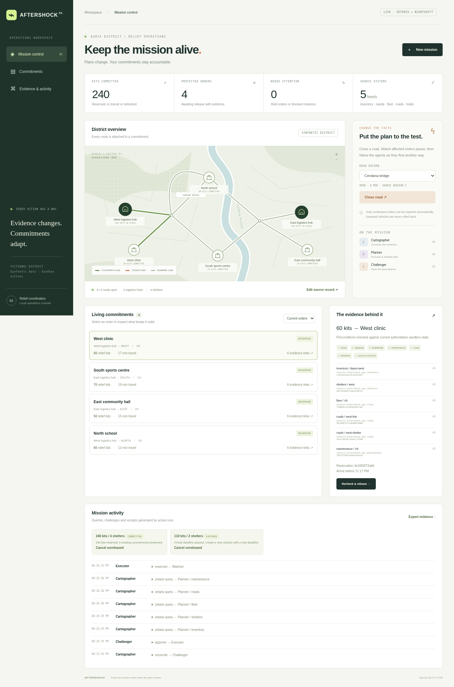
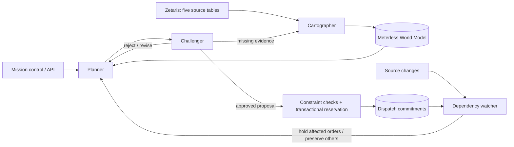

# AFTERSHOCK

**Keep the mission alive when the plan breaks.**

A working synthetic relief-dispatch sandbox for the Open Agent Hackathon, primary track **Reasoning Architecture**. Agents investigate fragmented evidence, challenge dispatches, and create persistent reservations. When a supporting source record changes, a watcher holds affected orders and replans their unmet demand. Unaffected commitments retain their IDs.



## Run

Node 22.13 or newer. No GPU required.

```bash
npm ci
npm start
# http://localhost:4317
```

The default is **sample mode**. It generates plans and traces from current input using deterministic policies. It does not call Zetaris or an LLM, and it is labelled accordingly everywhere. It is useful for judging the constraint, state, and repair behavior; it is not evidence of model autonomy. No saved answers are returned.

```bash
npm test
npm run check
npm run test:engines
```

Alternatively: `docker compose up --build`. The included Compose file runs sample mode and persists its sandbox state.

## Hosting

See [docs/HOSTING.md](docs/HOSTING.md) for a persistent-container deployment, Vercel limitations, and what must move off the laptop for live cloud operation. No cloud deployment is included in this repository.

## Live mode

Keep Zetaris and Nightshift running. Copy `.env.example` only if you do not already have a private `.env`. Set `APP_MODE=live`, your verified Zetaris API URL/token/organisation ID, and Nightshift Runtime URL/token/model route. The NVIDIA provider key stays in Nightshift.

```bash
APP_MODE=live npm start
npm run diagnose
npm run seed:zetaris              # preview registrations
npm run seed:zetaris -- --apply   # register synthetic sources
```

The source service runs on port 4318. Zetaris must be able to reach it. `SOURCE_PUBLIC_URL` selects its address; otherwise the setup script uses this machine's first non-loopback IPv4 address. Set a stable reachable address for repeatable installations. If that address changes, use a new `ZETARIS_DATABASE` namespace and register it, or update the registrations in Zetaris. Existing source registrations are not destructively replaced.

The registrations are `inventory`, `shelters`, `fleet`, `roads`, and `maintenance` under `aftershock_ops`. They are separate REST tables served by the sandbox: inventory is backed by SQLite, requests by CSV, and the fleet, access and maintenance feeds by JSON files. This demonstrates heterogeneous data formats through a shared source service, not five independent production systems. Agents read the tables through Zetaris. Writes are confined to our synthetic source and dispatch services.

Source and application state live under `data/runtime/`. Live and sample sources, orders and world state are isolated. Do not start two servers on the same data directory. The application API binds to localhost; the separate source service exposes only synthetic read-only records and must be reachable by Docker.

## Drive it programmatically

```bash
curl -X POST http://localhost:4317/api/missions \
  -H 'Content-Type: application/json' \
  -d '{"demands":[{"shelterId":"north","kits":60},{"shelterId":"east","kits":50}],"deadlineMinutes":90,"idempotencyKey":"mission-demo-1"}'
```

Returns a mission ID immediately. Poll `GET /api/missions/<id>` for its status, orders and actual generated trace. Same key + same inputs returns the existing mission. Reusing a key with different inputs returns 409.

Close the bridge through the ordinary source-edit API (read the current version from `/api/state` first):

```bash
curl -X POST http://localhost:4317/api/events \
  -H 'Content-Type: application/json' \
  -d '{"eventId":"bridge-closure-1","table":"roads","id":"bridge","expectedVersion":1,"patch":{"open":false}}'
```

The watcher holds unreleased affected orders before scheduling repair. Poll the mission to see replacement IDs, the cancelled originals and the preserved orders. Reopening the road uses `open:true` with its current version. The same endpoint supports stock, shelter demand, vehicle availability/capacity, road travel times and maintenance holds. Mission quantities remain operator commitments; editing shelter demand does not silently rewrite a mission's requested quantities.

- `GET /api/state`: district, sources, orders, missions and recent trace.
- `GET /api/health`: server health and execution mode.
- `POST /api/missions/<id>/retry`: retry a blocked mission against fresh evidence.
- `POST /api/orders/<id>/release`: revalidate and mark a reservation departed in the sandbox.
- `POST /api/orders/<id>/complete`: operator-acknowledged synthetic delivery receipt, only for departed orders.

## Architecture



Nightshift supplies live model calls. Meterless Markovian bounds the proposal/review loop; deterministic checks govern state mutations.

## Why these agents collaborate

**Cartographer** queries sources and writes versioned entities with provenance to Meterless World Model. The Planner reads that model's projection. **Planner** selects from computed allocation candidates using Nightshift in live mode. **Challenger** obtains the separate maintenance ledger, checks the proposal, and can reject it. A roster can claim V1 is available while its maintenance ledger holds it. That actual contradiction causes a revision, rather than a programmed sequence of fake trace messages. In sample mode the role policies are deterministic and explicitly identified.

The **Meterless Markovian** reference orchestrates up to three proposal/review rounds with bounded carryover. The exact constraints and exclusions stay in persistent structured state. Its checkpoints reference those records; they are not used as the source of quantities. Successful and failed chains are saved with per-call provider usage where returned. Engine text-cost estimates exclude extra model context and are not presented as measured savings.

The executor independently checks stock, fleet ownership, capacity, vehicle clearance, contiguous open routes, travel time, deadlines, evidence age and versions. Reservation writes use a SQLite transaction. The last check compares the observed evidence to current authoritative sandbox sources. Repeated requests cannot double-reserve a vehicle. The watcher checks every five seconds and immediately after a source-edit request. It does not count as another LLM agent.

## Evidence and reproduction

Application JSONL traces are emitted to stdout and `data/runtime/<mode>/logs/`. They include actual queries, proposals, rejections, revisions and reservation IDs. Persistent World Model events live under `.world/` inside the mode's runtime directory. Markovian chains live in `chains/`. Credentials are never intentionally logged or returned to the browser.

Tests cover a real local hold/repair cycle, preserving an unaffected order, conflicting idempotency keys, concurrent allocation, explicit shortfall, source-version conflicts, invalid input, deadline failures, release gates, process restart and twenty generated inputs. Separate provider tests check authentication failure and refusal to treat a truncated query page as a full snapshot. Official vendor conformance suites are included unchanged.

Three executable input examples and their generated sample outputs are in `input_examples/` and `output_examples/`. Regenerate with `npx tsx scripts/generate-examples.ts`. See [BUILD-STATUS.md](BUILD-STATUS.md) for measured live, browser and Docker evidence.

## Scope and limitations

This is one fictional district and one dispatch wave: two depots, four shelters, five vehicles and one kit type. Actual software reservations are persisted; no real vehicles or humanitarian deliveries are controlled. Source truth can still be wrong. No field deployment or domain validation is claimed.

The bounded search considers three greedy candidate strategies and simple paths, not a globally optimal schedule. A shortfall reports what this search could allocate; it is not a mathematical proof of infeasibility. Each vehicle is used once per wave; delivered stock remains accounted for. Orders expire after fifteen minutes before departure. A missing or changed source fails closed. Source rows are capped at 200; pagination beyond that limit is rejected.

Already departed orders are not rolled back by the watcher. Changes after departure require operator intervention; automated rerouting after departure is outside this build. A source-server outage or an unreachable provider can block live planning; the application does not silently switch a live mission to sample mode. Deadline time passes during reasoning.

## Sponsor components and prior work

- Zetaris: real REST query access to the registered operational tables. [Connector recipes](https://github.com/zetaris/getting-started).
- Meterless World Model and Markovian: vendored reference implementations, provenance and revision state in the working feature. [Upstream](https://github.com/Meterless/Meterless).
- Nightshift: primary live model provider, authenticated discovery and OpenAI-compatible requests. [Provider contract](https://github.com/Meterless/Meterless/blob/main/docs/agent-ready/add-meterless-provider.md).
- NVIDIA: actual response model and provider token usage are recorded when returned by Nightshift.

`vendor/NOTICE.md` records the pinned upstream commit and Apache-2.0 license. Sponsor source predates this build and must be declared as reused. Application implementation was written during the hackathon in this workspace. The user advised that Cursor is optional; this build does not claim to have been developed in Cursor. `IDEA.md` is the original proposal, not a list of shipped capabilities. Future comparisons and competition submission assets described there remain separate work.
